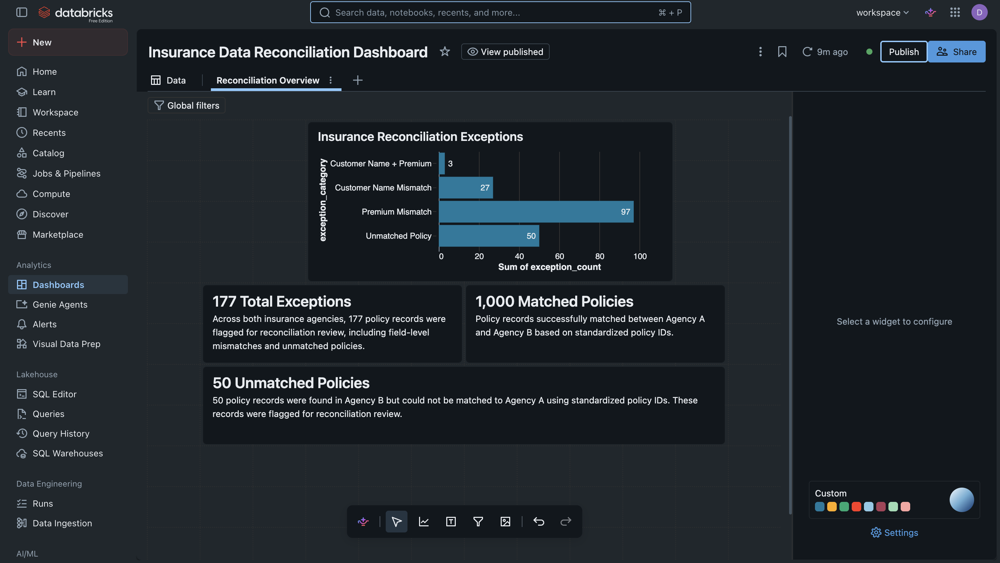

# Insurance Data Reconciliation and Quality Pipeline

## About the Project 🌷

I'm building this project to explore how data engineers handle messy data coming from different sources.

The idea is to simulate two insurance agencies sending policy data that doesn't always match. One agency might have a different policy ID format, a different premium amount, missing customer information, or even duplicate records.

I want to build a pipeline that can identify these differences, clean up the data, and eventually bring everything together into a reliable dataset.

I'm building this step by step, starting with synthetic data generation and moving through the different stages of a data pipeline.

## Tech Stack

- Python
- Pandas
- NumPy
- PyArrow
- Parquet
- Pytest
- Git and GitHub
- Databricks

## Project Structure

```text
insurance-data-reconciliation-pipeline/
│
├── data/
│   ├── raw/
│   │   ├── agency_a/
│   │   ├── agency_b/
│   │   └── generation_metadata.json
│   ├── bronze/
│   │   ├── agency_a/
│   │   └── agency_b/
│   ├── silver/
│   │   ├── agency_a/
│   │   └── agency_b/
│   ├── processed/
│   └── exceptions/
│
├── src/
│   ├── ingestion/
│   ├── transformations/
│   ├── reconciliation/
│   ├── quality/
│   ├── exceptions/
│   ├── reporting/
│   ├── marts/
│   └── warehouse/
│
├── tests/
├── docs/
│   ├── DAILY_PROGRESS.md
│   └── images/
│
├── generate_synthetic_data.py
├── requirements.txt
└── README.md
```

## What I've Built So Far

### 1. Synthetic Data Generation

Created two synthetic insurance datasets:

- Agency A: 1,000 records
- Agency B: 1,100 records

I intentionally introduced some data issues into Agency B:

- 100 premium mismatches
- 50 duplicate records
- 30 unique policies with missing customer names
- 50 unmatched policies
- Inconsistent policy ID formats and status values

I also checked that the data generator produces the same output when run again using a fixed random seed.

### 2. Bronze Layer Ingestion

Built a Python ingestion script that reads both agency CSV files and saves them in Parquet format.

Added metadata to track:

- Source system
- Original filename
- Ingestion timestamp
- Ingestion batch ID

I also implemented file hashing to prevent unchanged files from being ingested repeatedly.

**Validation results:**

- Agency A: 1,000 rows
- Agency B: 1,100 rows
- Both datasets contain 11 columns after adding metadata.
- Original missing values and duplicate records are preserved.

### 3. Silver Layer Transformations

Built a Silver transformation pipeline to standardize insurance data from both agencies.

Implemented transformations for:

- Standardizing policy IDs into a consistent format.
- Normalizing insurance status values, such as `In Force` to `Active`.

The transformations preserve the original DataFrame and other data columns.

Silver data is saved as Parquet files under the respective agency directories.

### 4. Silver Data Quality Checks

Built a data quality module to validate the standardized Silver datasets.

Implemented checks for:

- Missing required columns
- Missing policy IDs
- Duplicate policy IDs
- Missing customer names
- Missing premium values

The quality report assigns a status to each dataset:

- **PASS:** No issues detected by the implemented checks.
- **WARNING:** One or more data quality issues detected.
- **FAILED:** Required columns are missing.

**Current validation results:**

| Source | Records | Duplicate Policy IDs | Missing Customer Names | Quality Status |
|---|---:|---:|---:|---|
| Agency A | 1,000 | 0 | 0 | PASS |
| Agency B | 1,100 | 50 | 33 | WARNING |

These checks identify data issues without automatically removing or modifying records.

### 5. Insurance Data Reconciliation

Built a reconciliation engine to compare standardized insurance policy records between Agency A and Agency B.

Implemented:

- Removal of exact duplicate records before reconciliation.
- Detection of repeated policy IDs requiring investigation.
- Full outer join between the two agency datasets using standardized policy IDs.
- Field-level comparisons across customer name, carrier, premium, status, effective date, and expiration date.
- Classification of discrepancies by affected fields.
- Export of exception records to CSV and Parquet formats.

**Reconciliation results:**

| Metric | Result |
|---|---:|
| Agency A records | 1,000 |
| Agency B records after exact duplicate removal | 1,050 |
| Matched policies | 1,000 |
| Unmatched Agency B policies | 50 |
| Premium discrepancies | 100 |
| Customer name discrepancies | 30 |
| Unique exception records | 127 |
| Conflicting records requiring investigation | 0 |

Three policies had both premium and customer name discrepancies, resulting in 127 unique exception records.

The exception outputs are saved as:

- `data/exceptions/reconciliation_exceptions.csv`
- `data/exceptions/reconciliation_exceptions.parquet`

The 50 unmatched Agency B policies are identified separately from field-level exceptions and will be handled in a later stage.

### 6. Exception Management

Built an exception management workflow to turn reconciliation discrepancies into trackable records for review and resolution.

Implemented:

- Generation of unique exception IDs.
- Assignment of exception priorities.
- Tracking exception review statuses.
- Reviewer assignment.
- Resolution notes.
- Resolution timestamps.
- Updating exception records through a workflow.

The exception management dataset tracks field-level discrepancies separately from unmatched policies.

**Exception workflow:**

Exceptions can progress through the following statuses:

- Open
- In Review
- Resolved

The workflow supports assigning reviewers, recording resolution notes, and tracking when exceptions are resolved.

The exception management dataset is saved under `data/exceptions/`.

### 7. Exception Reporting

Built a reporting module to summarize exception records and monitor the exception resolution process.

Reporting metrics include:

- Total field-level exceptions.
- Open exceptions.
- Exceptions under review.
- Resolved exceptions.
- Unresolved exceptions.
- Exception priority distribution.
- Resolution rate.

**Current exception report:**

| Metric | Result |
|---|---:|
| Total field exceptions | 127 |
| Open exceptions | 126 |
| In Review | 0 |
| Resolved exceptions | 1 |
| Unresolved exceptions | 126 |
| High priority | 100 |
| Medium priority | 27 |
| Low priority | 0 |
| Resolution rate | 0.79% |

The exception summary is saved as:

- `data/exceptions/exception_summary.csv`

### 8. Fact Policy Analytics Layer

Built a Fact Policy dataset that consolidates reconciled insurance policy records from Agency A and Agency B into a unified analytical dataset.

Implemented:

- Consolidation of both agency datasets using a full outer join.
- Identification of matched and unmatched policies.
- Field-level discrepancy indicators.
- Premium mismatch flags.
- Customer name mismatch flags, including missing values for matched policies.
- Premium difference calculation between agencies.
- Export of the analytical dataset to CSV and Parquet formats.

**Fact Policy dataset results:**

| Metric | Result |
|---|---:|
| Total policy records | 1,050 |
| Matched policies | 1,000 |
| Missing from Agency A | 50 |
| Missing from Agency B | 0 |
| Field discrepancy records | 127 |
| Premium mismatches | 100 |
| Customer name mismatch flags | 80 |

The Fact Policy dataset is saved as:

- `data/processed/fact_policy.csv`
- `data/processed/fact_policy.parquet`

The dataset provides a foundation for downstream analytics, insurance reconciliation reporting, exception monitoring, and future data warehouse integration.

### 9. Automated Testing

Created automated tests using Pytest to validate the different modules of the pipeline.

Tests cover:

- Successful CSV-to-Parquet ingestion
- Preventing duplicate ingestion
- Creating a new batch when the source file changes
- Policy ID standardization
- Status normalization
- DataFrame preservation
- Silver data quality checks
- Quality report generation and validation
- Duplicate preparation for reconciliation
- Cross-agency matching
- Field-level comparisons
- Discrepancy classification
- Reconciliation runner execution
- Exception management dataset generation
- Exception reporting summary generation
- Fact Policy dataset generation and mismatch flag validation

**Current test results: 33 tests passed.**

The full test suite was executed using:

```bash
python -m pytest -v
```

### Databricks Reconciliation Dashboard

I also explored the reconciliation workflow using Databricks Free Edition.

Loaded and standardized the agency datasets in Databricks, performed cross-agency reconciliation, and created analytical tables to support dashboard reporting.

The Databricks reconciliation dashboard visualizes key metrics, including:

- Total exceptions
- Matched policies
- Unmatched policies
- Premium discrepancies
- Customer name discrepancies



## 🗺️ What's Next?

- [x] Generate synthetic insurance data
- [x] Build Bronze ingestion
- [x] Validate Bronze Parquet files
- [x] Test Bronze ingestion
- [x] Set up GitHub repository
- [x] Build Silver layer transformations
- [x] Standardize policy IDs and statuses
- [x] Add data quality checks
- [x] Build cross-agency reconciliation
- [x] Identify and classify field-level discrepancies
- [x] Export reconciliation exceptions
- [x] Test reconciliation runner
- [x] Build exception management workflow
- [x] Build exception reporting
- [x] Build Fact Policy analytics dataset
- [x] Add automated tests for Fact Policy
- [x] Validate full test suite
- [x] Explore Databricks reconciliation
- [x] Build Databricks reconciliation dashboard
- [ ] Investigate and handle unmatched policies
- [ ] Integrate a database or data warehouse
- [ ] Develop SQL analytics and reporting
- [ ] Orchestrate the pipeline using Airflow
- [ ] Expand the pipeline with additional data sources
