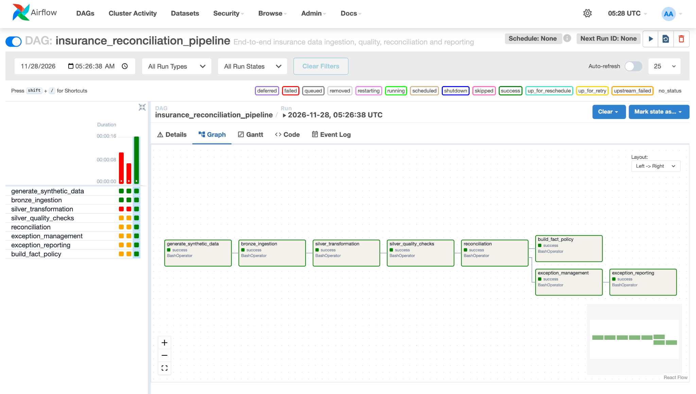
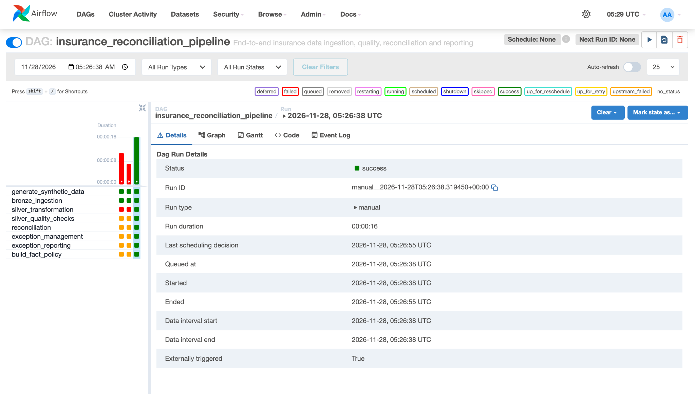

# Insurance Data Reconciliation and Quality Pipeline

## About the Project 🌷

I'm building this project to explore how data engineers take messy data from different sources and turn it into something reliable and useful.

The idea is to simulate two insurance agencies sending policy data that doesn't always agree. One agency might have a different policy ID format, a different premium amount, missing customer information, duplicate records, or inconsistent policy statuses.

I wanted to build something that goes beyond just cleaning data. I wanted to create a pipeline that could ingest data, standardize it, check its quality, compare records between agencies, identify discrepancies, track exceptions, and eventually make the data useful for analysis.

I've been building this project step by step, starting with synthetic data generation and gradually adding each part of the pipeline. Along the way, I've worked with Python, SQL, PostgreSQL, Databricks, testing, and recently, Apache Airflow to bring everything together.

It's also been a learning experience in debugging, figuring things out when they don't work the first time, and connecting individual scripts into a pipeline that actually runs end to end. 💛

## Tech Stack

- Python
- Pandas
- NumPy
- PyArrow
- Parquet
- PostgreSQL
- SQL
- SQLAlchemy
- Pytest
- Git and GitHub
- Databricks
- Apache Airflow
- Docker and Docker Compose

## Project Structure

```text
insurance-data-reconciliation-pipeline/
│
├── airflow/
│   ├── dags/
│   └── docker-compose.yaml
│
├── data/
│   ├── raw/
│   │   ├── agency_a/
│   │   ├── agency_b/
│   │   └── generation_metadata.json
│   ├── bronze/
│   │   ├── agency_a/
│   │   └── agency_b/
│   ├── silver/
│   │   ├── agency_a/
│   │   └── agency_b/
│   ├── processed/
│   └── exceptions/
│
├── src/
│   ├── ingestion/
│   ├── transformations/
│   ├── reconciliation/
│   ├── quality/
│   ├── exceptions/
│   ├── reporting/
│   ├── marts/
│   └── warehouse/
│
├── sql/
├── tests/
├── docs/
│   ├── DAILY_PROGRESS.md
│   └── images/
│
├── generate_synthetic_data.py
├── requirements.txt
└── README.md
```

## What I've Built So Far

### 1. Synthetic Data Generation

I started by creating two synthetic insurance datasets to simulate data coming from different agencies.

- Agency A: 1,000 records
- Agency B: 1,100 records

To make things interesting and simulate real-world data problems, I intentionally introduced some issues into Agency B:

- 100 premium mismatches
- 50 duplicate records
- 30 unique policies with missing customer names
- 50 unmatched policies
- Inconsistent policy ID formats
- Inconsistent policy status values

I also made the data generator reproducible using a fixed random seed, so I can regenerate the same datasets whenever I need to test the pipeline again.

### 2. Bronze Layer Ingestion

Next, I built the Bronze layer to ingest the agency CSV files and store them in Parquet format.

I wanted the ingestion process to do more than just read and save files, so I added metadata to help keep track of where the data came from and when it was processed.

The metadata includes:

- Source system
- Original filename
- Ingestion timestamp
- Ingestion batch ID

I also implemented SHA-256 file hashing to identify unchanged source files and avoid re-ingesting the same file versions.

**Validation results:**

| Source | Records |
|---|---:|
| Agency A | 1,000 |
| Agency B | 1,100 |

Both datasets contain 11 columns after adding ingestion metadata. The original missing values and duplicate records are preserved in the Bronze layer because I wanted to keep the incoming data intact and handle those issues in later stages.

### 3. Silver Layer Transformations

Once the data was ingested, I built the Silver layer to standardize the datasets and prepare them for reconciliation.

The transformations include:

- Standardizing policy IDs into a consistent format.
- Normalizing insurance status values, such as `In Force` to `Active`.
- Preserving the original DataFrames and other data columns.

The standardized datasets are saved as Parquet files under their respective agency directories.

This stage helps make the data more consistent before comparing records across the two agencies.

### 4. Silver Data Quality Checks

I added a data quality module to check the standardized Silver datasets before reconciliation.

I wanted to catch potential issues early instead of letting them silently flow into the next stage.

The checks cover:

- Missing required columns
- Missing policy IDs
- Duplicate policy IDs
- Missing customer names
- Missing premium values

The quality report assigns a status to each dataset:

- **PASS:** No issues detected by the implemented checks.
- **WARNING:** One or more data quality issues were detected.
- **FAILED:** Required columns are missing.

**Current validation results:**

| Source | Records | Duplicate Policy IDs | Missing Customer Names | Quality Status |
|---|---:|---:|---:|---|
| Agency A | 1,000 | 0 | 0 | PASS |
| Agency B | 1,100 | 50 | 33 | WARNING |

These checks help identify data issues without automatically removing or modifying records.

### 5. Insurance Data Reconciliation

This is where the two agency datasets finally come together.

I built a reconciliation engine to compare standardized insurance policy records between Agency A and Agency B and identify where their data doesn't match.

The reconciliation process includes:

- Removing exact duplicate records before reconciliation.
- Identifying repeated policy IDs that require investigation.
- Performing a full outer join using standardized policy IDs.
- Comparing customer names, carriers, premiums, statuses, effective dates, and expiration dates.
- Classifying discrepancies based on the affected fields.
- Exporting exception records to CSV and Parquet formats.

**Reconciliation results:**

| Metric | Result |
|---|---:|
| Agency A records | 1,000 |
| Agency B records after exact duplicate removal | 1,050 |
| Matched policies | 1,000 |
| Unmatched Agency B policies | 50 |
| Premium discrepancies | 100 |
| Customer name discrepancies | 30 |
| Unique exception records | 127 |
| Conflicting records requiring investigation | 0 |

Three policies had both premium and customer name discrepancies, which resulted in 127 unique field-level exception records.

The exception outputs are saved as:

- `data/exceptions/reconciliation_exceptions.csv`
- `data/exceptions/reconciliation_exceptions.parquet`

The 50 unmatched Agency B policies are identified separately from field-level exceptions and will be handled in a later stage.

### 6. Exception Management

After identifying the discrepancies, I wanted to make them easier to track instead of simply leaving them in a CSV file.

So I built an exception management workflow that creates records that can be followed through a review and resolution process.

It includes:

- Generating unique exception IDs.
- Assigning exception priorities.
- Tracking review statuses.
- Assigning reviewers.
- Recording resolution notes.
- Tracking resolution timestamps.
- Updating exceptions as they move through the workflow.

Exceptions can progress through the following statuses:

- Open
- In Review
- Resolved

The workflow supports assigning reviewers, recording resolution notes, and tracking when exceptions are resolved.

The exception management dataset is saved under `data/exceptions/`.

### 7. Exception Reporting

I also built a reporting module to get a quick overview of the exceptions generated during reconciliation and monitor their resolution progress.

Rather than manually reviewing every exception, the report summarizes the overall workload and highlights what still needs attention.

The report tracks:

- Total field-level exceptions.
- Open exceptions.
- Exceptions under review.
- Resolved exceptions.
- Unresolved exceptions.
- Exception priority distribution.
- Resolution rate.

**Current exception report:**

| Metric | Result |
|---|---:|
| Total field exceptions | 127 |
| Open exceptions | 126 |
| In Review | 0 |
| Resolved exceptions | 1 |
| Unresolved exceptions | 126 |
| High priority | 100 |
| Medium priority | 27 |
| Low priority | 0 |
| Resolution rate | 0.79% |

The exception summary is saved as:

- `data/exceptions/exception_summary.csv`

### 8. Fact Policy Analytics Layer

I built a Fact Policy dataset to bring together reconciled insurance policy records from both agencies into a single analytical dataset.

I wanted to make it easier to analyze policy matching results, identify where discrepancies exist, and have a dataset ready for downstream reporting and analytics.

It includes:

- Consolidation of both agency datasets using a full outer join.
- Identification of matched and unmatched policies.
- Field-level discrepancy indicators.
- Premium mismatch flags.
- Customer name mismatch flags, including missing values for matched policies.
- Premium difference calculations between agencies.
- Export of the analytical dataset to CSV and Parquet formats.

**Fact Policy dataset results:**

| Metric | Result |
|---|---:|
| Total policy records | 1,050 |
| Matched policies | 1,000 |
| Missing from Agency A | 50 |
| Missing from Agency B | 0 |
| Field discrepancy records | 127 |
| Premium mismatches | 100 |
| Customer name mismatch flags | 80 |

The customer name mismatch flag in the analytical dataset also captures missing-versus-present customer names, which is why it differs from the earlier reconciliation count of 30 name discrepancies.

The Fact Policy dataset is saved as:

- `data/processed/fact_policy.csv`
- `data/processed/fact_policy.parquet`

This dataset provides a foundation for downstream analytics, reconciliation reporting, exception monitoring, and warehouse integration.

### 9. Automated Testing

As the project grew, I started adding automated tests so I could validate the individual pipeline components instead of relying only on manual checks.

I created tests using Pytest to validate different modules of the pipeline.

The tests cover:

- CSV-to-Parquet ingestion.
- Preventing duplicate ingestion.
- Creating a new batch when the source file changes.
- Policy ID standardization.
- Status normalization.
- DataFrame preservation.
- Silver data quality checks.
- Quality report generation and validation.
- Duplicate preparation for reconciliation.
- Cross-agency matching.
- Field-level comparisons.
- Discrepancy classification.
- Reconciliation runner execution.
- Exception management dataset generation.
- Exception reporting summary generation.
- Fact Policy dataset generation and mismatch flag validation.

**Current test results: 33 tests passed.** 🎉

I run the full test suite using:

```bash
python -m pytest -v
```

### 10. Databricks Reconciliation Dashboard

I also wanted to explore how the reconciliation workflow could be handled in Databricks, so I worked with Databricks Free Edition.

I loaded and standardized the agency datasets in Databricks, performed cross-agency reconciliation, and created analytical tables to support dashboard reporting.

I created tables for reconciliation results, exceptions, and summary metrics.

The dashboard visualizes key metrics such as:

- Total exceptions
- Matched policies
- Unmatched policies
- Premium discrepancies
- Customer name discrepancies

Here's a look at the reconciliation dashboard I built in Databricks:


### 11. PostgreSQL Warehouse Integration

I added PostgreSQL to the project to store the analytical data and work with it using SQL.

I connected the Python pipeline to PostgreSQL using SQLAlchemy and loaded the Fact Policy dataset into a warehouse table.

I also loaded the exception management dataset so I could query policy-level analytics alongside exception priority and review status.

**Warehouse tables:**

- `fact_policy`: Stores policy-level reconciliation results, matching status, discrepancy flags, and premium differences.
- `exception_management`: Stores exception records, priorities, review statuses, and supporting reconciliation data.

**Warehouse validation results:**

| Metric | Result |
|---|---:|
| Total policy records | 1,050 |
| Matched policies | 1,000 |
| Missing from Agency A | 50 |
| Missing from Agency B | 0 |
| Premium mismatches | 100 |
| Customer name mismatch flags | 80 |
| Policies with discrepancies | 127 |

### 12. SQL Analytics

Once the data was in PostgreSQL, I started building reusable SQL queries to analyze the reconciliation results and exception workflow.

The queries cover:

- Policy reconciliation KPIs.
- Matched and unmatched policy counts.
- Premium and customer name mismatch counts.
- Total and average premium differences.
- Exception backlog by priority and review status.
- Exception resolution rates.
- Joining policy analytics with exception management records.

**Financial discrepancy analysis:**

| Metric | Result |
|---|---:|
| Premium mismatch count | 100 |
| Total premium difference | $50,000 |
| Average premium difference | $500 |

**Exception workflow analysis:**

| Priority | Total Exceptions | Open | Resolved | Resolution Rate |
|---|---:|---:|---:|---:|
| High | 100 | 99 | 1 | 1.00% |
| Medium | 27 | 27 | 0 | 0.00% |
| Total | 127 | 126 | 1 | 0.79% |

I also tested joining the Fact Policy and exception management tables using `policy_id` to connect analytical results with exception tracking information.

My SQL scripts are saved under the `sql/` directory so they can be reused and version controlled.

### 13. Bringing Everything Together with Airflow ✨

After building and testing the individual pipeline stages, I wanted to see if I could get the entire workflow running through Apache Airflow.

I set up Airflow using Docker and Docker Compose and created a DAG to orchestrate the pipeline from synthetic data generation all the way to the final Fact Policy dataset.

The DAG includes eight tasks:

1. Synthetic data generation
2. Bronze ingestion
3. Silver transformation
4. Silver quality checks
5. Policy reconciliation
6. Exception management
7. Exception reporting
8. Fact Policy dataset generation

Getting everything to work inside Docker wasn't completely smooth. I ran into Python import path issues and some corrupted Parquet files along the way. I had to troubleshoot the container environment, regenerate the Bronze data, and test the pipeline stages individually before trying the full DAG again.

And then... all eight tasks finally ran successfully! Seeing the entire DAG turn green was honestly one of my favorite milestones in this project. 💚

**Successful Airflow DAG run:**



**Airflow run details:**



The successful run completed in approximately 16 seconds, with all eight tasks passing.

This was a big step for me because it took the project from individual scripts that worked separately to a pipeline that could be orchestrated end to end.

## 🗺️ What's Next?

- [x] Generate synthetic insurance data
- [x] Build Bronze ingestion
- [x] Validate Bronze Parquet files
- [x] Test Bronze ingestion
- [x] Set up GitHub repository
- [x] Build Silver layer transformations
- [x] Standardize policy IDs and statuses
- [x] Add data quality checks
- [x] Build cross-agency reconciliation
- [x] Identify and classify field-level discrepancies
- [x] Export reconciliation exceptions
- [x] Test reconciliation runner
- [x] Build exception management workflow
- [x] Build exception reporting
- [x] Build Fact Policy analytics dataset
- [x] Add automated tests for Fact Policy
- [x] Validate full test suite
- [x] Explore Databricks reconciliation
- [x] Build Databricks reconciliation dashboard
- [x] Integrate PostgreSQL
- [x] Load Fact Policy and exception datasets into PostgreSQL
- [x] Build SQL analytics and reporting
- [x] Orchestrate the pipeline using Airflow
- [x] Run all eight Airflow tasks successfully
- [ ] Investigate and handle unmatched policies
- [ ] Expand the pipeline with additional data sources
